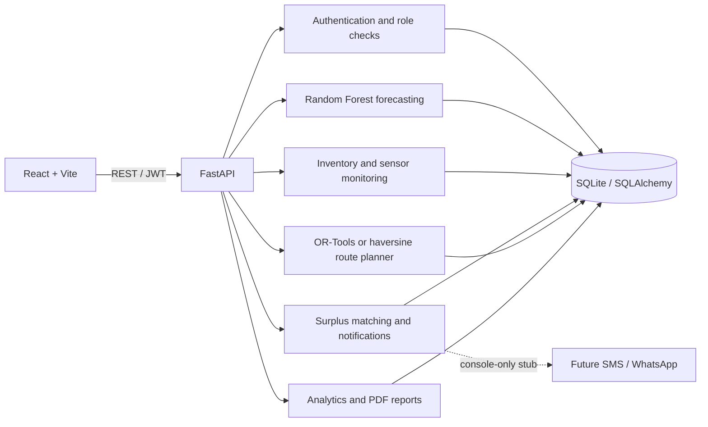

# AnnaSetu

AnnaSetu is a local-first MVP for institutional kitchens and NGO partners. It forecasts meal demand, monitors food shelf life, alerts nearby NGOs about safe surplus, plans pickup stops, and reports food and emissions impact.

## Features

- Role-aware accounts for Kitchen Admins, NGOs, and Super Admins, with hashed passwords and JWT access tokens.
- Seven-day Random Forest demand forecast based on historical daily records.
- Food inventory CRUD with FRESH, USE_SOON, EXPIRING, and EXPIRED shelf-life statuses.
- Sensor threshold checks and a clearly marked mock image freshness check.
- Safe-window surplus listings, distance-ranked NGO notifications, and pickup status tracking.
- Route planning uses Google OR-Tools when it is installed, otherwise a nearest-neighbour haversine fallback. OR-Tools is optional.
- Impact dashboard and downloadable monthly-style ESG PDF.
- In-app notifications. SMS/WhatsApp is a console-only Twilio integration stub; it sends no messages.

## Architecture



## Requirements

- Python 3.11 or newer
- Node.js 18 or newer and npm

## Setup

Open two terminals from the project root.

### Backend

```powershell
cd backend
python -m venv .venv
.\.venv\Scripts\Activate.ps1
python -m pip install -r requirements.txt
Copy-Item .env.example .env
python scripts\seed_data.py
uvicorn app.main:app --reload
```

The API is at `http://localhost:8000`; interactive documentation is at `http://localhost:8000/docs`.
To try the OR-Tools route optimizer on a Python version with a compatible wheel, install it with `python -m pip install ortools`; without it, AnnaSetu automatically uses the built-in fallback.

### Frontend

```powershell
cd frontend
npm install
npm run dev
```

Open `http://127.0.0.1:5173`. The frontend defaults to the local API at `http://127.0.0.1:8000/api`. To change it, set `VITE_API_URL` in a frontend `.env` file.
The optional frontend configuration template is in `frontend/.env.example`.

The API reads environment variables from the process environment. Copy `backend/.env.example` to `backend/.env` as a reference and set them in your terminal before starting Uvicorn if you want to override defaults. The default SQLite database is `backend/annasetu.db` when running commands from the backend directory.

## Demo logins

All demo accounts use password `demo1234`.

| Role | Email |
|---|---|
| Kitchen Admin | `kitchen@annasetu.demo` |
| Kitchen Admin | `canteen@annasetu.demo` |
| Kitchen Admin | `caterer@annasetu.demo` |
| NGO | `ngo@annasetu.demo` |
| NGO | `ngo2@annasetu.demo` |
| Super Admin | `admin@annasetu.demo` |

Seed data creates three kitchens and 180 days of synthetic records per kitchen. Running the seed command more than once will not duplicate the demo users or daily records.

## Full demo flow

1. Sign in as `kitchen@annasetu.demo` and open the dashboard to see the seven-day forecast. Optionally add an inventory item and view its expiry status.
2. On the dashboard, enter a food item, quantity, and a future **Safe until** time, then post it. The system ranks registered NGOs by distance and creates an in-app notification for up to five nearby partners.
3. Sign in as `ngo@annasetu.demo`. The surplus appears in the nearby list; accept it to notify the kitchen and assign the pickup.
4. Open **Route planner** to calculate an ordered route for accepted listings. The active optimizer reports approximate distance and ETA.
5. Use the pickup status controls to mark the listing **PICKED_UP**, then **DELIVERED**. Delivered listings contribute to kitchen and overall impact analytics.
6. Open **Impact & ESG** to view the updated metrics or download a PDF report.

Listings are only accepted while their safety window is still open. The browser's local session is role-specific; use a separate browser profile or sign out when switching demo identities.

## API overview

All application endpoints are under `/api`; protected endpoints require a JWT using Bearer authentication in the Authorization header.

| Area | Endpoints |
|---|---|
| Auth | `POST /auth/register`, `POST /auth/login` |
| Forecast | `POST /forecast`, `POST /forecast/records` |
| Inventory | `GET/POST /inventory`, `PUT/DELETE /inventory/{id}`, `POST /sensors`, `POST /quality-check` |
| Surplus | `POST/GET /surplus`, `POST /surplus/{id}/accept`, `/reject`, `/status?status=PICKED_UP` |
| Notifications | `GET /surplus/notifications`, `POST /surplus/notifications/{id}/read` |
| Routes | `POST /routes/plan` |
| Analytics | `GET /analytics`, `GET /analytics/report.pdf` (optional `month=YYYY-MM`) |
| Super Admin | `GET /admin/overview` |

Additional endpoint schemas and example requests are available in the FastAPI docs.

## Tests

```powershell
cd backend
python -m pip install -r requirements.txt
python -m pytest
```

## Notes and MVP limitations

- Emissions avoidance defaults to `2.5 kg CO2e per kg of food saved`; override `CO2_KG_PER_KG_FOOD`. Cost savings default to INR 80/kg and are configurable using `COST_SAVED_PER_KG`.
- Meals donated are estimated at three meals per kilogram. Use a local operational factor for formal reporting.
- Forecasting uses available historical records; the dashboard explains when there are not yet enough records.
- The image quality endpoint returns a mock label and is not a food safety determination.
- Sensor rules flag temperature above 8°C, humidity above 80%, or gas level above 50. Calibrate these thresholds to the actual sensor and food types before operational use.
- Inventory status thresholds are FRESH (>6 hours remaining), USE_SOON (more than 2 and up to 6 hours), EXPIRING (up to 2 hours), and EXPIRED (past shelf life).
- Configure production-grade secrets, HTTPS, migrations, monitoring, and access controls before deployment. This demo uses `create_all` and SQLite for local simplicity.
